Crio sistemas web que substituem controles manuais por fluxos com regras, aprovação e histórico. 
Atendo empresas, órgãos e projetos como autônomo.

<b>Clique em um dos botões para abrir</b>

 

| O que resolve | Como |
|---|---|
| Férias agendadas fora da regra | Valida período aquisitivo, data limite, venda de dias e antecedência, conforme a CLT |
| Aprovação por e-mail e planilha | Fluxo por perfil: Gestor solicita, RH aprova, DP acompanha |
| Cadastro digitado duas vezes | Sincronização diária com o ERP e login pela conta de rede |
| Posto sem ninguém nas férias | Indica quem cobre e envia a informação ao CGV |

**Tecnologias:** PHP 8 · MariaDB · JavaScript · Docker · Playwright

➡️ [Abrir o repositório do SAF](https://github.com/Igor-Wendel/SAF)

 

| O que resolve | Como |
|---|---|
| Posto de serviço descoberto | Registra a ausência e mostra quais volantes e intermitentes estão livres |
| Desconto na fatura por posto vazio | Guarda quem cobriu cada posto em cada dia |
| Fechamento do mês feito à mão | Calcula os dias cobertos e não cobertos por contrato |
| Informação espalhada | Dashboard, notificações por perfil e auditoria de cada alteração |

**Tecnologias:** PHP · MariaDB · JavaScript · Docker

➡️ [Abrir o repositório do CGV](https://github.com/Igor-Wendel/CGV)

 

  

## Sobre mim

- **Desenvolvedor Web Full Stack**, estudante de Ciência da Computação (Estácio).
- Dois sistemas em produção, usados por mais de 30 pessoas para controlar mais de 6.000 colaboradores.
- Do levantamento das regras à implantação: desenvolvimento, testes, segurança e documentação.
- Inglês intermediário.

## Contato

Aberto a oportunidades como desenvolvedor e a projetos como autônomo. Fale comigo pelo GitHub.

---

🇺🇸 <b>English:</b> Full stack web developer (PHP, SQL, JavaScript) and Computer Science student. I build web systems that replace manual controls with rule-based, auditable workflows. Two systems in production, used by 30+ people to manage 6,000+ employees: <a href="https://github.com/Igor-Wendel/SAF">SAF</a> (vacation scheduling) and <a href="https://github.com/Igor-Wendel/CGV">CGV</a> (position coverage management for outsourcing companies). Open to developer roles and freelance projects.
