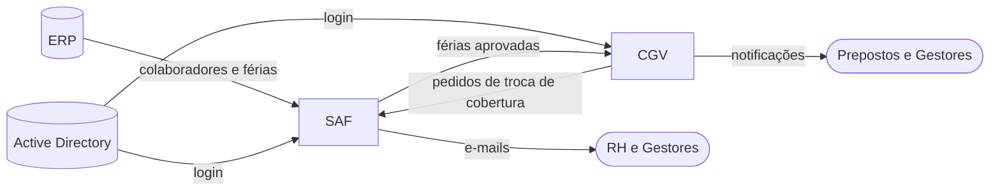

  

  

  
  

## Olá, eu sou o Igor 👋

**Desenvolvedor Web Full Stack** · PHP, SQL e JavaScript · estudante de Ciência da Computação

Crio sistemas web que substituem controles manuais por fluxos com regras, aprovação e histórico. Tenho dois sistemas em produção, usados por mais de 30 pessoas para controlar mais de 6.000 colaboradores, que desenvolvi do levantamento das regras à implantação.

Atuo em empresa e também como autônomo, criando sites e sistemas sob medida para empresas e órgãos.

## Projetos

| Projeto | O que é | Tecnologias |
|---|---|---|
| [**SAF**](https://github.com/Igor-Wendel/SAF) | Sistema de Agendamento de Férias: agendamento e aprovação com as regras da CLT, programação anual, relatórios e integração com ERP e Active Directory. | PHP 8 · MariaDB · JavaScript · Docker |
| [**CGV**](https://github.com/Igor-Wendel/CGV) | Controle Geral de Volantes: para empresas de terceirização, garante que nenhum posto de serviço fique descoberto em faltas, atestados, férias e desligamentos, com fechamento mensal, dashboard e notificações por perfil. | PHP · MariaDB · JavaScript · Docker |

Os dois sistemas trabalham juntos: o SAF informa as férias aprovadas e o CGV organiza quem cobre cada posto.

<b>▶ Clique para ver o que o SAF faz</b>

 

- Agendamento de férias com as regras da CLT: período aquisitivo, data limite, venda de dias e fracionamento.
- Fluxo de aprovação por perfil (Gestor, RH, DP, Financeiro e Admin).
- Sincronização diária com o ERP e login pela conta de rede.
- E-mails automáticos em fila, relatórios em Excel e dashboard.
- Mais de 120 cenários de teste automatizado no navegador.

<b>▶ Clique para ver o que o CGV faz</b>

 

- Feito para empresas que terceirizam serviços e precisam manter os postos cobertos para não ter desconto na fatura.
- Solicitações de cobertura por falta, atestado, férias, afastamento e desligamento.
- Designação de volantes dia a dia, com controle de quem está ocioso.
- Fechamento mensal por contrato, com prazo de ajuste.
- Dashboard de indicadores e notificações por perfil.
- Auditoria de todas as alterações.

<b>▶ Clique para ver como os dois se integram</b>

 

## O que eu uso

- **Linguagens:** PHP 8, JavaScript, SQL, HTML, CSS e Python
- **Banco de dados:** MariaDB/MySQL e SQL Server
- **Infraestrutura:** Docker, Git e GitLab CI/CD
- **Integrações:** ERP TOTVS Protheus, Active Directory (LDAP) e e-mail (SMTP)
- **Qualidade e segurança:** testes automatizados com Playwright, controle de acesso por perfil, auditoria e backup
- **Ferramentas:** desenvolvimento assistido por IA (Claude Code)

## Formação

- Bacharelado em Ciência da Computação · Estácio (cursando)
- Inglês intermediário

## Contato

Aberto a oportunidades como desenvolvedor e a projetos como autônomo. Fale comigo pelo GitHub.

---

🇺🇸 **English:** Full stack web developer (PHP, SQL, JavaScript) and Computer Science student. I build web systems that replace manual controls with rule-based, auditable workflows. Two systems in production, used by 30+ people to manage 6,000+ employees: <a href="https://github.com/Igor-Wendel/SAF">SAF</a> (vacation scheduling) and <a href="https://github.com/Igor-Wendel/CGV">CGV</a> (position coverage management for outsourcing companies). Open to developer roles and freelance projects.
